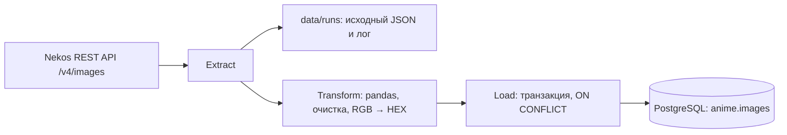
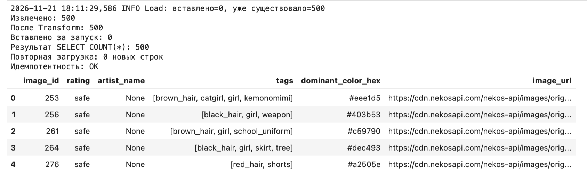

## 1. ДЗ-1. ETL каталога аниме-изображений

## 2. Источник

[Nekos API](https://nekosapi.com)

Endpoint: `GET https://api.nekosapi.com/v4/images`.

REST API

Датасет с ссылками на аниме картинки + их метаданные

## 3. Схема ответа API

Корень ответа: `items` - массив записей, `count` - общее число результатов.
Схема ответа:

| Поле | Тип JSON | Содержание |
| --- | --- | --- |
| `id` | integer | Идентификатор изображения |
| `url` | string | URL файла |
| `rating` | string | Категория |
| `artist_name` | string / null | Автор |
| `source_url` | string / null | Ссылка на оригинальный источник |
| `tags` | array of string | Теги изображения |
| `color_dominant` | array of integer | Rgb для основного цвета|
| `color_palette` | array of RGB arrays | Цветовая палитра |

Пример ответа:

```json
{
  "items": [{
    "id": 29813,
    "url": "https://cdn.nekosapi.com/nekos-api/images/original/c1faac62-010d-4366-afe2-4e2e74d9e17d.webp",
    "rating": "safe",
    "artist_name": null,
    "source_url": null,
    "tags": ["wet", "girl"],
    "color_dominant": [78, 127, 142],
    "color_palette": [[236, 232, 233], [55, 107, 125]]
  }
  ...],
  "count": 16209
}
```

### Объем данных

Без задания `limit` и `rating` api отдает 40656 изображений. Я возьму только sfw картинки (`rating='safe'`), их 16209

### Почему этот источник

Пусть многовато нейрослопа, но в целом неплохой датасет картинок с возможностью выбора палитры, хочу обучить на них stargan с возможностью генерировать по палитре.

## 4. Целевая таблица `anime.images`

| Колонка | Тип PostgreSQL |
| --- | --- |
| `image_id` | BIGINT PRIMARY KEY |
| `image_url` | TEXT NOT NULL |
| `rating` | TEXT NOT NULL | Возьмем `safe` |
| `artist_name` | TEXT NULL | Пустая строка → NULL |
| `source_url` | TEXT NULL | Некорректная или отсутствующая ссылка → NULL |
| `tags` | TEXT[] NOT NULL |
| `tag_count` | INTEGER |
| `dominant_color_hex` | CHAR(7) NULL |
| `color_palette` | JSONB NOT NULL |
| `extracted_at` | TIMESTAMPTZ NOT NULL |
| `loaded_at` | TIMESTAMPTZ NOT NULL |


## 5. Архитектура



PostgreSQL работает в Docker; Jupyter и Python — в локальном `.venv`.

## 6. Как запустить

Нужен Python 3.11–3.13

```bash
git clone https://github.com/hikkamisama/etl-anime.git
cd etl-anime
cp .env.example .env
```

Задайте свой `POSTGRES_PASSWORD` в `.env`
Порт по умолчанию - `127.0.0.1:5433`

```bash
docker compose up -d --wait
docker compose ps
python3 -m venv .venv
source .venv/bin/activate
python -m pip install -r requirements.txt
python -m jupyter lab notebooks/etl.ipynb
```

И внутри ui дойдите до клеточки с `SELECT`

Либо без ui:

```bash
source .venv/bin/activate
python -m jupyter nbconvert --to notebook --execute --inplace notebooks/etl.ipynb \
  --ExecutePreprocessor.timeout=300
```

Проверка SQL из контейнера (имя пользователя и БД берутся из его окружения):

```bash
docker compose exec postgres sh -c 'psql -U "$POSTGRES_USER" -d "$POSTGRES_DB" -c "SELECT COUNT(*) FROM anime.images; SELECT image_id, rating, tags, dominant_color_hex FROM anime.images ORDER BY image_id LIMIT 5;"'
```

## 7. Результат



## 8. Что можно улучшить

- Добавить запуск обновления бд из сурса по расписанию - добавлять новые картинки и обновлять авторов если они появляются
- В процессе transform проверять картинки на битость, зачищать невалидные
- Добавить скачку в пайплайн с хранением картинок в s3 + оставить posgres для метаданных

